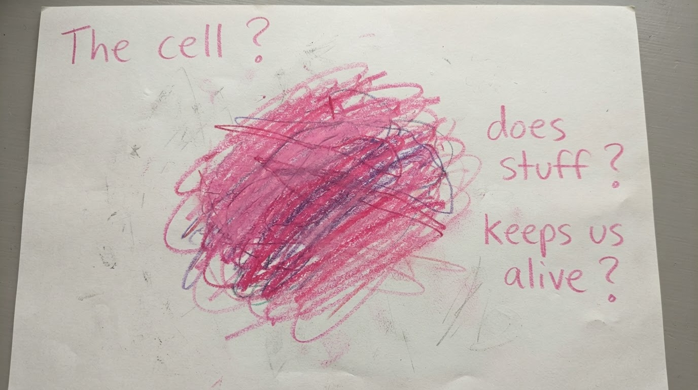
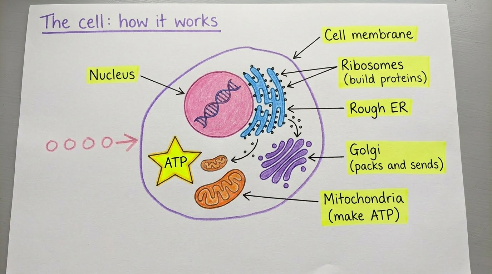

# Milo

You explain a topic out loud. Milo, a cartoon kid who knows nothing, draws exactly what you said. A weak explanation gets a messy crayon scribble. A good one gets a clean revision sheet. Milo never explains anything. He only asks about your biggest gap, and he grows up as you get it right.

Built at Imperial AI Hack, 14 to 15 November 2026. Track 03: Voice, Vision and Generative Media.

The app is on the [`Ali` branch](https://github.com/LumaHack/milo-submission/tree/Ali). The Devpost text is in [docs/DEVPOST.md](docs/DEVPOST.md).

**Demo video (1:52):** https://www.youtube.com/watch?v=Z5pfUKr4XBE

| What you said | What Milo drew |
|---|---|
| A vague first try |  |
| The full explanation |  |

These two boards are real fal output from our test runs.

## What Milo does

- **Draws what you said, and only that.** The same drawing is edited every turn, so it grows from a crayon scribble into a clean revision sheet as your explanation improves.
- **Follows, never leads.** After each thing you say he asks one small question about your biggest gap. He does not explain and does not use a word you have not used.
- **Checks facts before drawing.** A clearly wrong statement goes on the paper small and grey with a red question mark, and Milo asks about it first.
- **Teaches at one moment only.** After two tries at the same gap he sketches a small hint in blue dashed pencil. The idea only counts once you say it in your own words. If you still miss it, he lets that bit go.
- **Grows up.** Milo ages from 4 to 18 across the session.
- **Leaves you a revision sheet.** The final board, your explanation in your own words, how your level climbed, and what to look up next. It can be replayed as a slideshow or turned into a short film.

## How one turn works

1. **ElevenLabs agent** (WebRTC) hears the student. Before replying it calls a client tool in the browser, `next_line`.
2. **Claude** (`claude-opus-5-5`, structured outputs, streamed) fact-checks the turn, scores each key idea as missing, vague or clear, and writes Milo's next line and the drawing instruction in one call. The line is ready after about 1 to 2 seconds and goes back to the agent through the tool, so Milo always answers the turn the student just said.
3. **fal** (`google/nano-banana-2-lite/edit`) edits the previous board. One redraw runs at a time and the old board stays up until the new one has loaded. A redraw takes 5 to 9 seconds.
4. **The app** counts tries per gap and decides when the hint comes, when a gap is left behind and when the lesson is over. Those limits are not left to a model.

Every vendor key stays on the server. The browser only gets a short-lived ElevenLabs conversation token. There is no database: a session lives in memory and finished sheets are kept in `localStorage`.

Full detail: [docs/SPEC.md](docs/SPEC.md) for the turn contract, [docs/PROMPTS.md](docs/PROMPTS.md) for every prompt, [docs/DECISIONS.md](docs/DECISIONS.md) for why.

## What is real, and how it was tested

- Real: the voice conversation, the scoring, every board redraw, the film.
- Not live: Milo's face is four fal portraits swapped by level.
- Scripted: `/demo` replays stored boards with no voice and no calls, and says so on screen.
- Tested: ten of ten scripted spoken runs reached the final sheet on Sunday 15 November. The script plays recorded speech into the page's microphone against the live agent. Numbers and limits are in [docs/SUBMISSION.md](docs/SUBMISSION.md).

`nolan/` is a separate experiment and is not part of this submission.

## For the team

### Read these, in this order

| File | What it is |
|---|---|
| [docs/SPEC.md](docs/SPEC.md) | What we are building, screen by screen, and how one turn works |
| [docs/DESIGN.md](docs/DESIGN.md) | The v3 look: colours, type, layout, copy, motion rules |
| [docs/PROMPTS.md](docs/PROMPTS.md) | Every prompt: the tested fal prompts, Claude's brief, Milo's voice |
| [docs/BACKLOG.md](docs/BACKLOG.md) | What to build, in order, with checkpoints |
| [docs/DECISIONS.md](docs/DECISIONS.md) | What we already decided and why. Don't reopen these |
| [docs/SUBMISSION.md](docs/SUBMISSION.md) | Deadlines, rules, the video script, the Devpost checklist |
| [docs/DEVPOST.md](docs/DEVPOST.md) | The Devpost entry: problem, what we built, how it works, APIs and models |
| [CLAUDE.md](CLAUDE.md) | Rules for any AI working in this repo |

The design itself: [Milo v3 on Claude Design](https://claude.ai/artifact/KAwE1srdFEsi4zZrdwsW3R?sk=u5se3NDV8fmoEE4lxJQz3w#page-717156d19b2e), page "v3, final". That is the look we are going for. A snapshot of those screens is in [design/](design/).

### The one rule

**Nobody pushes to `main`.** Work on your own branch and do whatever you want there.

| Branch | Owner |
|---|---|
| `Antoine` | Antoine |
| `Yusuf` | Yusuf |
| `Ali` | Ali |

`main` only changes through a pull request that the team agrees on. Details in [docs/BACKLOG.md](docs/BACKLOG.md), "How the three branches work".

## Setup

```bash
git clone git@github.com:LumaHack/milo-submission.git
cd milo-submission
git checkout Ali            # or Antoine, or Yusuf
git config core.hooksPath .githooks   # blocks an accidental push to main
cp .env.example .env.local  # then fill in the keys
```

Keys are shared in the team chat, never in this repo. `.env.local` is ignored by git.

The stack and the package versions we checked are in [docs/SPEC.md](docs/SPEC.md).

### Running the app (branch `Ali`)

```bash
pnpm install
```

```bash
pnpm dev
```

Then open http://localhost:3000.

| Page | What it is |
|---|---|
| `/` | Start screen. Pick the cell topic or type your own, and how much detail |
| `/session` | The live session. It connects by itself: allow the microphone and start explaining the cell to Milo. The round button under Milo switches him off and on |
| `/demo` | The scripted run from stored images. No keys or network. The header says "Scripted run" |
| `/sheet` | A session's revision sheet, with a slideshow and a fal film of the drawing growing up |
| `/sheets` | Every session saved in this browser |

It needs `FAL_KEY`, `ANTHROPIC_API_KEY`, `ELEVENLABS_API_KEY` and `ELEVENLABS_AGENT_ID` in `.env.local`. Milo's agent is created once with `curl -X POST http://localhost:3000/api/elevenlabs/setup`, which prints the id.

**Testing without a microphone** (development only, in the browser console on `/session`):

- `window.miloText()` reconnects to the real ElevenLabs agent in text mode, so no microphone is needed.
- `window.miloSay("...")` says a turn. In text mode Milo answers it for real.
- `window.miloLog` lists everything Milo said, plus the reason for any dropped connection.

**A spoken test with no human.** `scripts/voice-test/talk.js` opens the app in headless Chrome, swaps the microphone for recorded speech, says two sentences about the cell and prints a timeline of what Milo heard, said and drew. Run `python3 scripts/voice-test/make_voice.py` once to make the voice, `npm install --no-save puppeteer-core`, then `node scripts/voice-test/talk.js`. It uses the real agent, so each run costs a little.

**If pages start reloading by themselves** in development, stop `pnpm dev`, delete the `.next` folder and start it again. It happened once after many restarts: the build cache went bad and every page reloaded about 20 times a second. Because the session page connects to Milo by itself, every reload also asked ElevenLabs for a voice token. ElevenLabs then refused new calls for a while with "workspace has reached its maximum concurrent capacity", although its own call list showed nothing in progress. The same limit is shared by everyone using the team's key, so two people testing at once can also hit it.

**After changing a prompt** in `src/lib/prompts.ts`, restart `pnpm dev` and then run the setup route again. The dev server has twice served an old copy of a changed file to a route, and the agent ended up with an outdated first line. The setup route now prints the first line it sent, so check it.

Use Chrome for the live session. The microphone only works on `localhost` or https.

## What is in here besides docs

- `design/boards/` the four whiteboards, real fal output from our test run
- `design/milo/` Milo at four ages, real fal output
- `design/claude-design/` the v3 screens as HTML, to copy exact sizes and spacing from
- `scripts/fal_speed_test.py` the test that produced the boards and the timings. Run it to check your fal key works
- `scripts/gen_milo.py` the script that drew Milo

## Team

Ali, Yusuf, Antoine.
